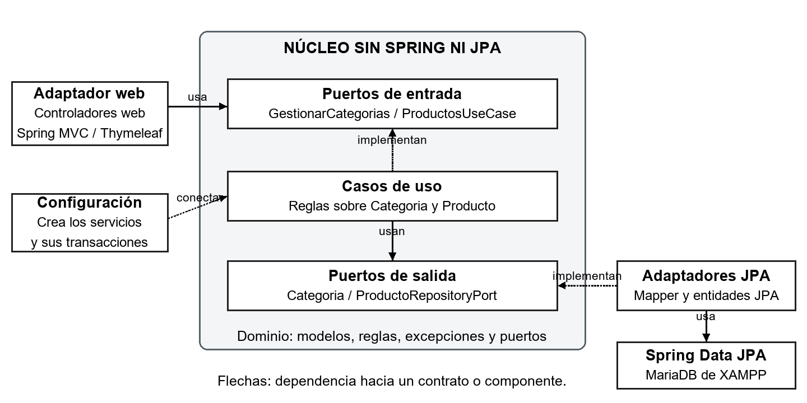
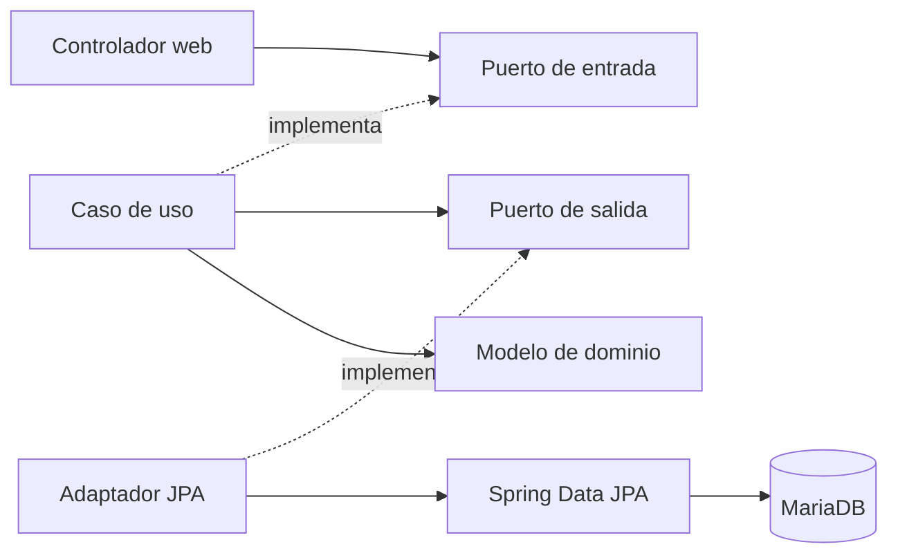

# Migración de Ockly de MVC a arquitectura hexagonal

Ockly es el sistema de la papelería que trabajamos en la actividad anterior. Permite administrar categorías y productos, revisar precios y existencias y mantener la relación entre ambos. En esta entrega reorganizamos ese mismo proyecto con arquitectura hexagonal. Conservamos las pantallas, las rutas y las tablas de la base de datos.

## Comparación

| Aspecto | MVC anterior | Hexagonal implementada |
| --- | --- | --- |
| Propósito | Organizar la interacción entre modelo, vista y controlador. | Separar el negocio de la web y de la persistencia mediante contratos. |
| Organización | controller, model, service y repository, más las vistas. | domain, application e infrastructure, con puertos y adaptadores. |
| Responsabilidades | El controlador atiende la web; el modelo representa datos; el servicio aplica reglas; el repositorio guarda y consulta. | El dominio expresa datos y reglas; los casos de uso coordinan; los puertos son contratos; los adaptadores conectan tecnologías. |
| Dependencias | Los servicios conocían Spring Data y los modelos tenían JPA. InicioController consultaba repositorios directamente. | Los controladores dependen de puertos de entrada y los servicios de puertos de salida. JPA queda en infraestructura. |
| Ventajas | Menos clases y un recorrido sencillo para un CRUD pequeño. | Reglas que pueden probarse sin Spring ni base de datos y cambios de infraestructura más localizados. |
| Limitaciones | En esta implementación, cambiar la persistencia podía afectar servicios y modelos. | Exige más interfaces, mapeos y configuración; hay más archivos que mantener. |
| Cuándo usarla | Proyectos pequeños, formularios simples y equipos que necesitan una solución rápida. | Sistemas que crecen, tienen reglas importantes o necesitan distintas entradas y formas de guardar datos. |

Para el tamaño actual de Ockly, MVC era suficiente. La migración tiene sentido como ejercicio y como preparación para crecer. No quitamos Spring MVC de la web: sus controladores siguen funcionando, pero ahora son adaptadores de entrada. MVC y hexagonal pueden convivir; aquí cambió la organización y la dirección de las dependencias del sistema.

## Estructura

```text
src/main/java/co/edu/pascualbravo/ockly/
├── domain/
│   ├── model/
│   ├── exception/
│   └── port/
│       ├── in/
│       └── out/
├── application/service/
├── infrastructure/
│   ├── adapter/in/web/form/
│   ├── adapter/out/persistence/
│   └── config/
└── OcklyApplication.java
src/main/resources/
├── templates/
├── static/
└── application.properties
database/schema.sql
src/test/java/co/edu/pascualbravo/ockly/
```

| Paquete | Responsabilidad y componentes |
| --- | --- |
| domain/model | Categoria, Producto y ReglasCatalogo. Java sin Spring ni JPA. |
| domain/exception | Errores del negocio, sin códigos HTTP. |
| domain/port/in | GestionarCategoriasUseCase y GestionarProductosUseCase: operaciones disponibles. |
| domain/port/out | CategoriaRepositoryPort y ProductoRepositoryPort: persistencia que necesitan los casos de uso. |
| application/service | GestionarCategoriasService y GestionarProductosService: coordinación del CRUD y las reglas. |
| infrastructure/adapter/in/web | Controladores, formularios y traducción de errores a HTTP. |
| infrastructure/adapter/out/persistence | Entidades JPA, repositorios Spring Data, mapper y adaptadores que implementan los puertos de salida. |
| infrastructure/config | CatalogoConfiguration conecta los componentes y configura las transacciones desde fuera del núcleo. |

## Diagrama de la solución





## Reflexión arquitectónica

### 1. Cambios importantes

Separamos Categoria y Producto de sus entidades JPA, creamos los puertos y movimos la web y la persistencia a adaptadores. Los servicios dejaron de usar repositorios Spring Data y formularios web. También sacamos los errores HTTP del negocio. No fue solo cambiar carpetas.

### 2. Componentes conservados y reorganizados

Conservamos los atributos de las dos entidades, las tablas categorias y productos, su clave foránea, las pantallas Thymeleaf y las rutas. Los controladores se convirtieron en adaptadores de entrada. Los repositorios y las anotaciones JPA quedaron en persistencia; los formularios y sus validaciones de presentación quedaron en la web.

### 3. Bajo acoplamiento

GestionarProductosService recibe ProductoRepositoryPort y CategoriaRepositoryPort por constructor. No sabe qué repositorio JPA los implementa. Los controladores solo conocen los casos de uso. Las pruebas comprueban que domain y application no importen Spring, Jakarta ni infraestructura.

### 4. Alta cohesión

Cada grupo tiene una tarea concreta. ReglasCatalogo revisa los datos del negocio; los servicios coordinan las operaciones; el mapper convierte objetos; los adaptadores JPA guardan y consultan. La configuración de Spring y las transacciones están juntas en infraestructura, sin mezclarse con las reglas.

### 5. Ventajas para Ockly

Ahora podemos probar las reglas con dobles de los puertos, sin iniciar Spring ni MySQL. También sería más fácil agregar una API o cambiar la persistencia usando los mismos casos de uso. A cambio, debemos mantener más clases y las conversiones entre dominio y entidades.

### 6. Cuándo conservar MVC

Si Ockly siguiera siendo un CRUD pequeño, con una sola interfaz y sin cambios previstos en la base de datos, conservar MVC por capas sería una decisión razonable. Es más simple de recorrer y requiere menos configuración. La arquitectura hexagonal no es obligatoria para todos los proyectos.

### 7. Si cambia la base de datos

Si seguimos usando JPA, revisaríamos el controlador JDBC, la URL, las credenciales, el esquema SQL y los detalles de las entidades o consultas que cambien entre motores. Si dejamos JPA, crearíamos otro adaptador que implemente los mismos puertos de salida y ajustaríamos su configuración y las pruebas de persistencia. El dominio, los casos de uso y la web podrían conservarse si los contratos siguen cubriendo lo necesario.

## Verificación

| Comprobación | Resultado |
| --- | --- |
| Reglas y casos de uso sin Spring ni base de datos | 17 pruebas aprobadas |
| Integración de web, casos de uso y JPA con H2 | 5 pruebas aprobadas |
| Reglas de dependencias de la arquitectura | 2 pruebas aprobadas |
| CRUD y validaciones con MariaDB real | 21 comprobaciones aprobadas |
| Datos tras migrar y reiniciar | Registros anteriores conservados |

Las comprobaciones reales usan la base existente. Solo se eliminaron registros temporales creados para la prueba. `datos-antes.tsv` y `datos-despues.tsv` coinciden. El reinicio también conservó los registros.

## Conclusión

La transformación mantuvo el funcionamiento y los datos del Ockly anterior. El cambio más útil fue dejar claras las fronteras del negocio. Las pruebas aisladas muestran que las reglas ya no necesitan una base de datos para comprobarse. Para una aplicación pequeña esto añade trabajo, pero facilita entender qué parte habría que cambiar si el sistema crece.
